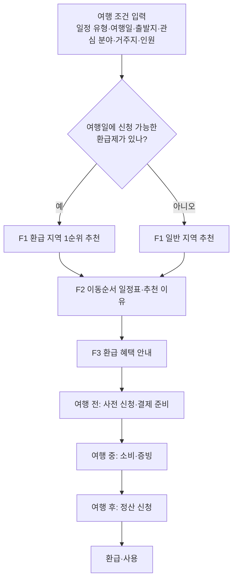

# 광주·전남 관광코스 추천 서비스 기능 정의서

2026-10-30 · @Haram

반값여행 같은 관광소비 환급제가 운영 중인 지역을 먼저 추천하고, 이동순서 일정표와 환급 받는 절차까지 안내하는 광주·전남 당일·1박2일 코스 추천 서비스다. 주제보드 16번을 바탕으로 하며, 해커톤 규칙(핵심 기능 최대 3개)에 맞춰 MVP를 F1~F3으로 정의한다.

## 서비스 개요

여행 시간·출발지·관심 분야를 받아 광주 문화관광과 전남 자연관광을 잇는 코스를 만들되, 환급제가 열린 지역을 먼저 세우고 환급 절차까지 안내한다.

**해결할 문제**

- 환급제 정보가 시군별 공고로 흩어져 있고, 기간·대상·한도·절차가 제각각이다.
- 사전 신청, 영수증·인증 사진 제출, 기한 내 정산 중 하나만 놓쳐도 환급을 받지 못한다.
- 기존 코스 추천은 '어디가 좋은가'만 알려 주고 '어디 가면 돌려받는가'는 알려 주지 않는다.

**기존 코스 추천 서비스와의 차별점**

| 구분 | 기존 코스 추천 | 이 서비스 |
| --- | --- | --- |
| 지역 선정 | 인기·취향 순 | 환급제 운영 지역 우선, 그다음 취향·이동시간 |
| 혜택 정보 | 사용자가 따로 검색 | 지역 카드와 일정표에 환급률·한도·예상 환급액 표시 |
| 절차 안내 | 없음 | 여행 전·중·후 할 일과 기한(D-day), 신청 링크 |
| 일정 구성 | 장소 나열 | 숙박·식사를 환급 지역 안에 배치해 환급 인정 지출을 키움 |
| 추천 근거 | 인기도 | 관광공사 관광 빅데이터(중심·연관 관광지) + 지자체 공고 |

**타깃 사용자**

- 1차: 광주 거주 20~40대. 자차로 전남 당일·1박2일 여행을 떠나는 커플·친구·가족.
- 2차: 수도권 등 외지 관광객. KTX로 광주송정역에 도착해 1박2일을 보내는 여행자.
- 공통: 환급 자격이 거주지에 따라 갈리므로(공고별 확인) 거주 시군을 입력받아 판정한다.

## 사용자 흐름



환급제가 없으면 일반 지역 추천과 일정표(F2)에서 끝나고, 환급 지역이면 F3가 여행 전·중·후 할 일을 날짜와 신청 링크로 이어서 안내한다.

## 기능 목록

핵심 기능은 F1~F3 세 개다. S1~S2는 핵심 기능이 돌아가게 하는 필수 보조 기능, S3~S5는 시간이 남을 때 붙이는 선택 기능이다.

| ID | 기능 | 설명 | 구분 | 사용 데이터 |
| --- | --- | --- | --- | --- |
| F1 | 환급 우선 관광지 추천 | 여행 조건을 받아 환급제 운영 지역을 먼저, 그다음 취향·이동시간 순으로 지역 3곳과 관광지 후보를 추천 | 핵심 | 환급제 DB, 중심·연관 관광지, KorService2 |
| F2 | 이동순서 일정표·추천 이유 | 시간·거리 제약 안에서 방문 순서와 시간표를 만들고 장소별 추천 이유를 붙임 | 핵심 | KorService2, 연관 관광지, Bedrock |
| F3 | 환급 혜택 안내 | 자격 확인, 예상 환급액, 여행 전·중·후 할 일과 기한, 신청 링크 표시 | 핵심 | 환급제 DB |
| S1 | 관광 데이터 수집·캐시 | 4개 API를 광주·전남 범위로 미리 수집해 SQLite에 저장하고, 화면 요청은 캐시로 응답 | 필수 보조 | 4개 공공 API |
| S2 | 환급제 정보 등록 | 지자체 공고를 사람이 확인해 JSON 시드로 등록하고 상태·기준일 관리 | 필수 보조 | 지자체·문체부 공고 |
| S3 | 지도 동선 표시 | 일정표 장소를 지도에 방문 순서대로 표시 | 선택 | 좌표, (선택) Amazon Location Service |
| S4 | 코스 저장·공유 | 생성한 코스를 저장하고 링크로 공유 | 선택 | SQLite |
| S5 | 기한 캘린더 추가 | 사전 신청·정산 기한을 .ics 파일로 내려받기 | 선택 | 환급제 DB |

**이번에 구현하지 않을 범위**

- 숙박·교통 실제 예약과 결제, 전국 단위 관광지 최적화 (주제 가이드 제외 범위)
- 환급 사전 신청·정산 신청 대행. 공식 신청 페이지로 연결만 한다.
- 회원가입·로그인, 거주 시군 외 개인정보 저장
- 예산 잔액 실시간 연동. 공개 API가 없어 접수 상태를 수동으로 갱신한다.

영수증 촬영·인식, 환급 규정 Q&A 챗봇, 환급받은 지역화폐로 다시 가는 코스는 행사 이후 확장 후보로 둔다.

## F1. 환급 우선 관광지 추천

여행일에 신청 가능한 환급제가 있는 시군을 1순위 그룹으로 올리고, 그룹 안에서는 취향·이동시간 점수로 정렬해 지역 3곳과 관광지 후보를 보여 준다.

**입력 항목**

| 항목 | 값 | 필수 | 쓰임 |
| --- | --- | --- | --- |
| 일정 유형 | 당일 / 1박2일 | 필수 | 슬롯 수, 이동시간 상한 |
| 여행 시작일 | 날짜 | 필수 | 운영기간·사전 신청 마감 판정 |
| 출발지 | 광주 5개 구, 광주송정역, 목포역, 순천역, 여수엑스포역 | 필수 | 이동시간 기준점 |
| 관심 분야 | 자연·바다, 역사·문화, 맛집, 체험·레저, 힐링·산책 중 1~3개 | 필수 | 취향 점수 |
| 거주 시군구 | 시도 → 시군구 선택 | 필수 | 거주지 제외 조건 판정 |
| 인원 | 1명 / 2명 이상 | 필수 | 환급 한도 구간 |
| 이동수단 | 자차(기본) / 대중교통 | 선택 | 이동시간 보정 |

**처리 규칙**

1. 환급제 필터: 아래를 모두 만족하는 프로그램만 '적용 가능'으로 본다.
   - 여행 기간이 운영기간 안에 있고, 접수 상태가 '접수중'이다(예산 소진·조기 마감 제외).
   - 오늘이 '여행 시작일 − 사전 신청 기한' 이전이다(예: 섬 반값여행은 5일 전).
   - 거주 시군구가 제외 지역이 아니고, 인원 조건을 충족한다.
2. 그룹 나누기: 적용 가능한 프로그램이 있는 시군이 1순위, 나머지가 2순위다. 1순위 그룹은 점수와 관계없이 항상 앞에 온다.
3. 이동시간 상한: 출발지에서 편도 추정 시간이 당일 150분, 1박2일 240분을 넘는 시군은 환급 여부와 관계없이 뺀다.
4. 그룹 안 점수(100점): 아래 표로 계산하고, 동점이면 환급 한도가 큰 시군이 앞이다.
5. 광주 연결: 출발지가 광주이고 당일 편도 90분 이하(1박2일은 항상)면, 광주 문화관광지 1곳을 코스 첫 장소 후보로 함께 고른다.
6. 관광지 후보: 선택 시군의 중심 관광지 상위 10곳과 그 연관 관광지 상위 10곳(같은 시군 우선)을 모아 관심 분야로 거르고 상세 정보를 붙인다.

| 점수 항목 | 배점 | 계산 | 데이터 |
| --- | --- | --- | --- |
| 취향 적합도 | 40 | 시군 관광지·문화시설·레포츠 중 관심 분야에 맞는 비율 × 40 | KorService2 분류체계(lclsSystm) |
| 이동 접근성 | 30 | 편도 60분 이하 30점, 상한까지 선형 감소 | 좌표 + 이동시간 추정식(F2) |
| 대표 관광지 | 20 | 중심 관광지 상위 5곳 중 관심 분야에 맞는 곳 1곳당 4점 | 기초지자체 중심 관광지 |
| 시기 가산 | 10 | 여행일에 열리는 축제·행사가 1건 이상이면 10점 | KorService2 행사정보조회 |

관심 분야는 분류체계 대분류에 맞춘다: 자연·바다→자연관광, 역사·문화→역사·문화관광, 맛집→음식, 체험·레저→체험관광·레저스포츠, 힐링·산책→자연관광 중 공원·숲. 코드값은 분류체계 코드조회로 받아 매핑 표를 만든다.

**출력**

- 추천 지역 카드 3장: 시군명, 환급 배지(제도명·환급률·한도·접수 상태), 추천 이유 태그 2~3개(예: 반값여행 적용 · 바다 일치 · 광주에서 70분), 대표 관광지 사진 3장
- 관광지 후보 목록: 사진, 분류, 한 줄 소개, 근거('○○군 중심 관광지 1위', '△△ 방문객이 함께 찾는 곳')

**예외 처리**

- 적용 가능한 환급제가 없다: 2순위 그룹만 추천하고, "선택한 날짜에 신청 가능한 환급제가 없어요"와 가장 가까운 접수중·운영 예정 프로그램을 함께 보여 준다.
- 사전 신청 기한이 지났다: 배지를 '신청 마감'으로 바꾸고 1순위에서 뺀다. 여행일을 미루면 가능한지도 알려 준다.
- 정보 기준일이 7일 넘게 지났다: 배지 옆에 '공고 재확인 필요'를 표시한다.
- 캐시에 관광지가 5곳 미만이다: 팀이 고른 시연 데이터(시군별 15~20곳)로 채운다.

**수용 기준** (Kiro requirements에 옮길 문장)

1. 여행일과 거주 시군구를 입력하면, 시스템은 적용 가능한 환급제가 있는 시군을 결과 목록 맨 앞에 표시해야 한다.
2. 2순위 시군의 점수가 더 높아도, 시스템은 그 시군을 1순위 시군 뒤에 표시해야 한다.
3. 거주 시군구가 프로그램의 제외 지역이면, 시스템은 그 프로그램을 적용 가능으로 판정하지 않아야 한다.
4. 사전 신청 기한이 지난 여행일이면, 시스템은 배지를 '신청 마감'으로 표시해야 한다.
5. 시스템은 추천 지역마다 추천 이유 태그를 2개 이상 표시해야 한다.

## F2. 이동순서 일정표·추천 이유

F1에서 고른 지역과 후보 관광지로 시간대별 일정표를 만들고, 장소마다 데이터 근거와 한 문장 설명을 붙인다. 당일은 장소 4~5곳, 1박2일은 식사·숙박을 포함해 8~10곳이 기본이다.

**시간표 틀** (기준 시각이며, 실제 시각은 이동시간으로 다시 계산)

| 일정 | 슬롯 순서 |
| --- | --- |
| 당일 | 관광지① 10:00 → 점심 12:00 → 관광지② 13:30 → 관광지③ 15:30 → 저녁(선택) 17:30 → 귀가 |
| 1박2일 1일차 | 광주 문화관광지 10:00 → 점심(환급 지역) 12:30 → 관광지② 14:00 → 관광지③ 16:00 → 저녁 18:30 → 숙박(환급 지역) |
| 1박2일 2일차 | 숙소 출발 09:30 → 관광지④ → 관광지⑤ → 점심 12:00 → 관광지⑥ 13:30 → 귀가 16:00 |

**동선·시간 규칙**

1. 체류시간 기본값: 관광지 90분, 문화시설 60분, 레포츠·체험 120분, 식사 60분. 문화시설 소개정보에 관람 소요시간이 있으면 그 값을 쓴다.
2. 이동시간 추정(Amazon Location Service를 쓰지 않을 때): 직선거리 20km 이상은 거리×1.3÷60km/h, 20km 미만은 거리×1.4÷35km/h로 계산하고 장소마다 주차·도보 5분을 더한다. 대중교통은 ×1.5 후 '실제 배차 확인' 문구를 붙인다.
3. 순서 정렬: 출발지(2일차는 숙소)에서 가장 가까운 장소부터 최근접 이웃으로 잇고, 2-opt로 경로 교차를 한 번 정리한다. 식사는 기준 시각에 가장 가까운 자리에 끼운다.
4. 제약: 아래를 어기는 장소는 빼고 다음 후보로 바꾼다.
   - 연속한 두 장소의 이동은 40분 이하를 권장하고, 넘으면 경고를 표시한다.
   - 휴무일·운영시간 밖 방문은 금지한다. 소개정보의 쉬는날·이용시간 텍스트에서 요일 키워드를 읽고, 못 읽으면 '방문 전 확인' 배지를 단다.
   - 당일은 마지막 장소 종료 19:00 이전, 1박2일 2일차는 귀가 출발 17:00 이전이다.
5. 식당: 식사 직전 장소 반경 5km 안 음식점(위치기반 관광정보조회, contentTypeId=39) 중 연관 관광지 데이터에 함께 등장한 곳을 먼저 고른다. 환급제가 지역 가맹점 결제만 인정하면 환급 지역 안 업소만 고른다.
6. 숙소(1박2일): 환급 지역 안 숙박(숙박정보조회) 중 1일차 마지막 장소와 가장 가까운 곳을 고른다. 숙박비는 지출 비중이 커서 환급 지역 안에 두면 환급액이 커진다.

환급제 조건도 일정 제약으로 넣는다. 필수 방문지(무안황토갯벌랜드 포함 2곳, 섬 반값여행 대상 섬 1곳 이상)는 코스에 고정하고, 숙박 요일 조건(무안: 월~금 체크인)에 맞지 않는 날짜면 날짜 변경부터 제안한다.

**추천 이유 생성**

- 근거 태그는 규칙으로 먼저 만든다: 환급 지역, 관심 분야 일치, '○○군 중심 관광지 2위', '△△ 방문객이 함께 찾는 곳 3위', '이전 장소에서 15분'.
- Bedrock은 태그와 장소 소개(overview) 앞 200자를 받아 장소당 30자 이내 한 문장으로 다듬는다. 기본 모델은 Claude Haiku 4.5다.
- 공통 API 제약(지시문 300자, 입력 4,000자, 응답 256토큰)에 맞춰 하루 일정당 1회, 코스당 최대 2회 호출한다. AI는 관광지(하루 최대 4곳)에만 쓰고, 식당·숙소는 규칙 문장만 쓴다.
- 입력에 없는 가격·운영시간·환급 조건은 쓰지 않게 지시한다. 금액과 기한은 AI 문장에 넣지 않고 DB 값을 화면에 직접 표시한다.
- 429(한도 초과)·502 오류면 근거 태그를 이어 붙인 규칙 문장으로 대신한다. 같은 코스 재요청은 저장해 둔 문장을 다시 쓴다.

지시문 예시(300자 이내):

```text
아래 장소별 tags와 overview에 있는 사실만 써서, 장소마다 30자 이내 추천 이유 한 문장을 작성하라. 가격·운영시간·환급 조건은 쓰지 마라. '번호. 문장' 형식으로 한 줄씩만 출력하라.
```

**출력 형식** (프론트·백엔드 공통, kind = spot · meal · stay)

```json
{
  "trip_type": "1N2D",
  "region": {"sigungu_code": "<법정동 시군구코드>", "name": "<시군명>", "refund_program_id": "<환급제 ID>"},
  "days": [{
    "day": 1,
    "items": [{
      "order": 1, "start": "10:00", "end": "11:30", "kind": "spot",
      "place": {"content_id": "<KorService2 contentid>", "title": "<장소명>", "lat": 0.0, "lng": 0.0},
      "move_min_from_prev": 0,
      "reason_tags": ["광주 문화관광", "관심 분야: 역사·문화"],
      "reason_text": "<AI 또는 규칙 문장>",
      "refund_note": "영수증 보관"
    }]
  }],
  "estimated_spend_krw": 0,
  "estimated_refund_krw": 0
}
```

**수용 기준** (pytest 케이스로도 옮길 문장)

1. 당일 일정이면, 시스템은 마지막 장소 종료 시각을 19:00 이전으로 맞춰야 한다.
2. 연속한 두 장소의 추정 이동시간이 40분을 넘으면, 시스템은 그 구간에 경고를 표시해야 한다.
3. 여행일이 장소의 휴무일이면, 시스템은 그 장소를 일정에 넣지 않아야 한다.
4. AI 호출이 실패해도, 시스템은 모든 장소에 근거 태그 1개 이상과 규칙 문장을 표시해야 한다.
5. 환급 지역 1박2일이면, 시스템은 숙소를 그 지역 안에서 골라야 한다.
6. 환급제에 필수 방문지가 있으면, 시스템은 그 장소를 일정에 포함해야 한다.
7. 환급제에 숙박 요일 조건이 있으면, 시스템은 조건에 맞는 날에만 숙박을 넣어야 한다.

## F3. 환급 혜택 안내

일정표 옆에 이 여행으로 받을 수 있는 예상 환급액과 지금 할 일을 보여 주고, 여행 전·중·후 절차를 날짜가 박힌 체크리스트로 안내한다. 절차 내용은 프로그램마다 환급제 DB 값으로 채운다.

**자격 확인** (질문에 답하면 '가능 / 확인 필요 / 불가'로 판정)

| 질문 | 판정 근거 | 예시(공고 기준) |
| --- | --- | --- |
| 거주지가 대상 지역 밖인가 | 제외 지역 목록 | 섬 반값여행: 대상 섬이 속한 시군구 외 거주자. 지역사랑 휴가지원: 거주지 인접 지역은 제한될 수 있음 |
| 나이·청년 조건은 | 최소 연령, 청년 여부 | 지역사랑 휴가지원: 18세 이상, 청년(19~34세)은 환급률 70%·한도 14만 원 |
| 여행일이 운영기간 안이고 접수 중인가 | 기간·접수 상태 | 섬 반값여행: 2026-08-29~11-04 |
| 사전 신청 기한 전인가 | 여행 시작일 − N일 | 섬 반값여행: 시작 5일 전까지 |
| 숙박·방문 조건을 지키나 | 숙박 요일, 필수 방문지 | 무안 반값여행: 월~금 체크인 1박 이상, 무안황토갯벌랜드 포함 2곳 방문 |
| 인정 결제 수단을 쓸 수 있나 | 결제 조건 | 섬 반값여행: 시군 지역화폐 앱(Chak·그리고) 가맹점 결제 |

**예상 환급액 계산**

- 예상 환급액 = min(인정 지출 × 환급률, 한도). 환급률·한도는 인원·청년 여부·박 수에 맞는 값을 쓴다(지역사랑 휴가지원: 개인 10만·2인 이상 20만 원, 청년 70%·14만 원 / 무안: 1박형 개인 10만·팀 20만 원, 2박 이상 개인 20만·팀 40만 원).
- 최소 지출 조건이 있으면 먼저 확인한다(무안: 1박형 10만 원, 2박 이상 20만 원). 모자라면 '○원 더 쓰면 환급 대상'으로 안내한다.
- 인정 지출 = 식사 횟수 × 인원 × 1인 식비(기본 12,000원, 사용자 수정) + 숙박 1박 요금(숙박 반복정보의 객실 요금, 없으면 기본 100,000원) + 유료 관광지·체험 요금(소개정보 이용요금에서 숫자를 읽은 경우).
- 인정 업종·지역이 정해진 프로그램은 그 항목만 더한다. 섬 반값여행은 섬에서 3만 원 이상 쓰면 그 시군 가맹점 사용분까지 인정한다(8월 6일 보도는 5만 원, 공고 확인).
- 예: 2인 1박2일, 식사 4끼×2명×12,000원 + 숙박 100,000원 = 196,000원 → 환급 98,000원(2인 이상 한도 20만 원 이내).
- 화면에는 '한도까지 ○원 더 쓰면 최대 환급' 게이지와 '예상치이며 실제 환급은 지자체 심사 결과를 따른다'는 문구를 함께 둔다.

**단계별 절차** (기본 틀, 괄호는 섬 반값여행 값)

1. 여행 전 · 사전 신청: 공식 앱·누리집에서 여행 계획을 신청하고 승인받는다. 기한 = 여행 시작일 − N일. (JG TOUR 앱·누리집, 시작 5일 전까지, 거주지 확인용 신분증 등록)
2. 여행 전 · 결제 준비: 인정 결제 수단을 준비한다. (방문 시군의 지역화폐 앱 Chak·그리고 설치·가입)
3. 여행 중 · 소비·증빙: 인정 업종 가맹점에서 결제하고 영수증·결제 내역을 남긴다. 일정표의 '영수증 보관' 표시 장소에서 알려 준다. (숙박·음식·카페·체험시설)
4. 여행 후 · 정산 신청: 기한 안에 증빙을 내고 환급을 신청한다. 기한 = 여행 종료일 + N일. (종료 후 10일 이내, JG TOUR 앱)
5. 환급·사용: 심사 후 모바일 지역화폐로 받는다. 사용처와 사용 기한을 안내한다. (해당 지역 재방문·지역 온라인몰, 지역사랑 휴가지원은 해당 연도 안)

**화면 구성 요소**

- 환급 카드: 제도명, 환급률, 한도, 운영기간, 접수 상태, 정보 기준일, 공고 원문 링크
- 예상 환급액 게이지와 계산 내역 펼침
- 할 일 타임라인: 단계별 실제 날짜(여행일 기준 자동 계산)와 신청 바로가기 버튼

**수용 기준**

1. 환급 지역 코스를 열면, 시스템은 환급 카드·예상 환급액·단계별 절차를 한 화면에 표시해야 한다.
2. 시스템은 예상 환급액이 한도를 넘지 않게 계산하고, 계산에 쓴 지출 항목을 펼쳐 보여야 한다.
3. 시스템은 각 단계 기한을 여행일 기준 실제 날짜로 계산해 표시해야 한다.
4. 정보 기준일이 7일을 넘으면, 시스템은 '공고 재확인 필요' 경고를 표시해야 한다.
5. 신청 버튼은 환급제 DB에 저장된 공식 URL로만 연결해야 한다.

## 데이터·API 연계

공공 API 4개는 행사 전에 광주 5개 구·전남 22개 시군 범위로 미리 수집해 SQLite에 넣고, 화면 요청은 캐시만 읽는다. 환급제는 공개 API가 없어 공고를 보고 직접 만든 DB를 쓴다.

| 데이터 | 쓰는 오퍼레이션 | 핵심 파라미터 | 쓰는 항목 | 기능 | 수집 방식 |
| --- | --- | --- | --- | --- | --- |
| [전국관광지정보표준데이터](https://www.data.go.kr/data/15021141/standard.do) | `tn_pubr_public_trrsrt_api` | pageNo, numOfRows, type=json | 관광지명·구분, 주소, 위도·경도, 주차가능수, 수용인원수, 편익·문화시설 정보, 관광지소개 | F1 후보 보강, F2 좌표 | 전체를 한 번 받아 주소로 광주·전남만 저장(연 1회 갱신 데이터) |
| [국문 관광정보 KorService2](https://www.data.go.kr/data/15101578/openapi.do) | 지역기반·위치기반·행사·숙박·공통·소개·반복정보조회, 법정동·분류체계 코드조회 | MobileOS, MobileApp, _type=json, lDongRegnCd·lDongSignguCd, contentTypeId, mapX·mapY·radius, eventStartDate | contentid, title, addr1, mapx(경도)·mapy(위도), firstimage, lclsSystm1~3, overview, 쉬는날·이용시간·주차, 객실 요금 | F1 취향 점수·후보, F2 식당·숙소·체류시간, F3 지출 추정 | 목록은 시군별로 미리 수집, 상세는 후보 장소만 받아 캐시 |
| [관광지별 연관 관광지 TarRlteTarService1](https://www.data.go.kr/data/15128560/openapi.do) | 지역기반 목록(areaBasedList1), 키워드 검색(searchKeyword1) | baseYm(YYYYMM), areaCd, signguCd(모두 필수), keyword | 관광지명, 연관 관광지명·순위·시군구·분류 | F1 후보 확장, F2 다음 장소·식당 선택, 추천 이유 태그 | 27개 시군구 × 기준연월 1개 미리 수집 |
| [기초지자체 중심 관광지 LocgoHubTarService1](https://www.data.go.kr/data/15128559/openapi.do) | 지역기반 중심 관광지 목록(areaBasedList1) | baseYm, areaCd(예: 11), signguCd(예: 11530) | 중심 관광지명·순위·좌표·분류 | F1 대표 관광지 점수, F2 코스 기준점 | 27개 시군구 미리 수집 |
| 환급제 DB(자체) | — | — | 다음 절의 필드 | F1 필터, F3 전체 | 공고 확인 후 JSON 시드 입력, 접수 상태 수시 갱신 |

**연계 규칙**

- 공통 요청값: 모든 관광공사 API에 serviceKey, MobileOS=WEB, MobileApp=서비스명, _type=json을 보낸다. KorService2의 지역코드조회·서비스분류코드조회는 삭제 예정이라 법정동·분류체계 코드만 쓴다. 숙박정보조회는 lDongRegnCd가 필수다.
- 지역 코드: 내부 기준 키는 시군구 코드 하나로 맞춘다. KorService2의 lDongRegnCd·lDongSignguCd와 연관·중심 관광지의 areaCd·signguCd를 첫 수집 때 대조해 매핑 표를 만든다.
- 행정구역 변경: 2026-07-01 전남광주통합특별시가 출범했다. 법정동코드조회를 lDongRegnCd 없이 불러 시도 코드가 바뀌었는지 확인하고, 주소 필터는 '광주광역시'·'전라남도'·'전남광주' 표기를 모두 받는다.
- 기준연월: 포털에 연관 관광지 제공 기간이 2024.5~2025.4로 적혀 있다. 이번 달부터 한 달씩 내려가며 응답이 있는 최신 baseYm을 찾고, 가능하면 여행 달과 같은 달(예: 10월)을 쓴다.
- 장소 매칭: 연관·중심 관광지의 관광지 코드는 KorService2 contentid와 다를 수 있다. 이름 정규화(공백·괄호 제거) + KorService2 키워드 검색 + 같은 시군구 조건으로 contentid를 붙이고, 실패분은 수동 매핑 표로 채운다.
- 응답 필드명: 포털에 연관·중심 관광지의 응답 항목이 적혀 있지 않다. 활용가이드 문서나 첫 응답으로 항목명을 확정한 뒤 모델을 만든다.
- 호출량: 수집은 스크립트 1회로 끝내고 상세 조회는 후보 장소로 제한해, 개발계정 일일 트래픽 안에서 끝낸다.

저장 테이블은 backend/app/team/models.py에 둔다: place(장소 마스터와 contentid 매핑), hub_rank(중심 관광지 순위), related_place(연관 관광지 쌍과 순위), refund_program(환급제), course(생성한 코스 JSON).

## 환급제 정보

2026-10-30 기준 광주·전남에서 확인한 관광소비 환급제는 4종이고, 모두 사전 신청·승인이 필수다. 예산이 정해진 선착순 사업이라(지역사랑 휴가지원 지자체당 10억 원, 무안 6,000만 원) 빨리 마감되므로(영월 3차 사전신청 경쟁률 25대 1), 접수 상태와 정보 기준일을 필수 필드로 둔다.

| 프로그램 | 대상 지역 | 여행 기간 | 환급·한도 | 신청·정산 | 상태 |
| --- | --- | --- | --- | --- | --- |
| [2026 갯벌愛 무안 반값여행](https://news.mtn.co.kr/news-detail/2026091118124235889) | 무안군. 무안황토갯벌랜드 포함 관광지 2곳 이상 방문 | 2026년 9~12월. 월~금 체크인 1박 이상(토·일 체크인 제외) | 숙박·음식점·카페·로컬푸드·특산품·체험·입장료 50%. 1박형(지출 10만 원 이상) 개인 10만·팀 20만 원, 2박 이상(지출 20만 원 이상) 개인 20만·팀 40만 원. 모바일 무안사랑상품권 | 9월 14일부터 예산 소진 시까지 선착순 사전 신청·승인 → 여행 후 7일 이내 숙박 자료·방문 사진·영수증 제출 | 확인 필요 |
| [지역사랑 휴가지원 하반기](https://view.asiae.co.kr/article/2026090416020175550) | 장흥군(하반기 신규 9곳 중 전남) | 8월 말부터 차수별, 종료일은 공고 확인 | 50%, 청년(19~34세) 70%. 개인 10만·청년 14만·2인 이상 20만 원, 가족 최대 5명 50만 원. 모바일 지역사랑상품권 | 대한민국 구석구석에서 차수별 선착순 사전 신청·승인 → 여행 후 영수증·방문 인증 제출. 거주지 인접 지역은 제한될 수 있음 | 확인 필요 |
| [전남광주 섬 반값여행](https://m.go.seoul.co.kr/news/2026/08/06/20260806500202) | 목포 달리도·외달도, 여수 하화도·사도·거문도·개도·금오도, 고흥 쑥섬·연홍도, 보성 장도, 강진 가우도, 영광 송이도, 진도 관매도, 신안 흑산도·반월박지도·증도 ([섬 목록](https://news.mtn.co.kr/news-detail/2026083016565081727)) | 2026-08-29 ~ 11-04. 오늘 신청하면 11-04 당일 여행만 가능 | 숙박·음식·카페·체험 50%, 1인 최대 10만 원. 섬에서 3만 원 이상 쓰면 그 시군 가맹점 사용분도 인정(8월 6일 보도는 5만 원). 모바일 지역화폐 | JG TOUR 앱·누리집에서 시작 5일 전까지 사전 신청(신분증 등록) → 종료 후 10일 이내 환급 신청 | 마감 임박 |
| [지역사랑 휴가지원 상반기](https://www.newsis.com/view/NISX20260227_0003528809) | 강진·해남·고흥·완도·영암·영광 ([전남광주 6개 군](https://www.segye.com/newsView/20260727518262)) | 4월부터 군별 차수 운영(7~8월 3차 모집까지 보도) | 50%, 개인 10만·2인 이상 20만 원. 모바일 지역사랑상품권(해당 연도 안 사용) | 18세 이상, 사전 신청·승인 → 여행 후 지출 증빙 제출 | 확인 필요 |

광주(5개 구)에서는 관광소비 환급제를 찾지 못했다. 광주는 문화관광 출발지로 쓰고, 환급은 전남 시군에서 받는 구조다.

**환급제 DB 필드** (예시는 무안 반값여행, 괄호는 다른 프로그램 값)

| 필드 | 예시 | 쓰임 |
| --- | --- | --- |
| id, name, operator | muan_2026, 2026 갯벌愛 무안 반값여행, 무안군 | 카드 표시 |
| region_codes | 무안군 시군 코드 (섬 반값여행은 8개 시군) | F1 1순위 그룹 판정 |
| required_places, min_spots | 무안황토갯벌랜드, 2곳 이상 (섬 반값여행은 대상 섬 1곳 이상) | F2 필수 방문지 |
| trip_start, trip_end | 9월~12월(정확한 날짜는 공고 확인) | F1 기간 판정 |
| stay_rule | 월~금 체크인 1박 이상 | F2 숙박 요일 제약 |
| status | 접수중 · 마감 임박 · 조기마감 · 예산소진 · 종료 | F1 필터 |
| exclude_residence, min_age | 무안군 주민등록자 (휴가지원은 인접 지역 제한 가능, 18세 이상) | F3 자격 확인 |
| refund_rate, youth_rate | 0.5 (휴가지원 청년 0.7) | F3 환급액 계산 |
| caps, min_spend | 1박형 개인 10만·팀 20만 원(지출 10만 원 이상), 2박 이상 개인 20만·팀 40만 원(지출 20만 원 이상) | F3 환급액 계산 |
| eligible_spend, spend_rule | 숙박·음식점·카페·로컬푸드·특산품·체험·입장료 (섬: 섬 3만 원 이상 사용 시 시군 가맹점 인정) | F3 계산, F2 식당 선택 |
| payment_rule | (섬) 시군 지역화폐 앱 Chak·그리고 가맹점 결제 | F3 체크리스트 |
| pre_apply_days, settle_days | 승인 후 여행, 7 (섬: 5, 10) | F3 기한 계산 |
| proof_items | 숙박 자료, 방문 사진, 영수증 | F3 증빙 체크리스트 |
| payout, voucher_use | 모바일 무안사랑상품권 (섬: 재방문·지역 온라인몰) | F3 안내 |
| apply_url, source_url | 공식 신청 페이지, 공고 원문 | 신청 버튼, 출처 |
| verified_at | 2026-10-30 | 정보 기준일, 7일 경과 시 경고 |

## 제약·비기능 요구사항

Kirothon 공통 템플릿과 서버 규칙 안에서 만들고, AI 호출 한도와 외부 데이터 의존은 캐시와 규칙 기반 대체로 흡수한다.

| 구분 | 요구사항 | 근거 |
| --- | --- | --- |
| 기술 스택 | Python 3.12·FastAPI·SQLModel/SQLite, React·Vite·TypeScript·Tailwind CSS 4·shadcn/ui. 팀 테이블은 team/models.py, API는 team/routes.py에 둔다 | .kiro/steering/tech.md |
| 추가 금지 | Docker·RDS·Redis·벡터DB를 추가하지 않는다. 그래서 환급 규정 RAG 챗봇은 범위 밖이다 | tech.md, data-policy.md |
| 외부 호출 | 공공 API는 lock 파일에 있는 httpx 0.28.1로 부른다. 새 패키지·AWS 서비스는 멘토에게 신청한다 | requirements.lock, 3조 가이드 |
| AI 호출 | POST /api/ai/generate 한 곳으로 부른다. 분당 20회·하루 600회, 응답 256토큰, 지시문 300자·입력 4,000자. 로컬은 mock이고 실제 결과는 팀 서버에서 확인한다 | backend/app/ai_service.py |
| 인증키 | 공공데이터 인증키는 서버 .env에만 두고 Git·프론트에 넣지 않는다. httpx params에는 Decoding 키를 넣는다(Encoding 키는 이중 인코딩됨) | data-policy.md |
| 응답 시간 | 지역 추천·일정표는 캐시 기준 3초 안에 보인다. AI 문장은 일정표를 먼저 보여 준 뒤 채운다 | — |
| 장애 대응 | 공공 API·Bedrock이 실패해도 캐시와 규칙 문장으로 응답해 화면이 비지 않는다 | — |
| 정보 신뢰 | 환급 정보마다 정보 기준일과 공고 원문 링크를 보이고, 예상 환급액에는 면책 문구를 단다 | — |
| 저작권 | 관광공사 이미지는 저작권 유형 필드(cpyrhtDivCd)를 확인하고 출처 '한국관광공사'를 표기한다 | KorService2 |
| 개인정보 | 로그인이 없다. 거주 시군구·인원은 판정에만 쓰고 저장하지 않는다. 저장 대상은 관광 캐시·환급제·생성 코스뿐이다 | .kiro/specs/_template/requirements.md |

## 확인 필요 사항

아래 항목은 공고·API 응답으로만 확정할 수 있어, 구현 전에 팀이 확인하거나 결정한다.

- [ ] 서비스명 확정
- [ ] 시연 시나리오 확정: 무안 반값여행·장흥 하반기 휴가지원의 현재 접수 여부를 확인해 시드 상태값을 갱신한다. 접수 중인 곳이 없으면 기준일을 운영기간 안 날짜로 두고 재현할지 정한다(화면에 기준일 표시).
- [ ] 무안 반값여행의 신청 채널(URL)과 정확한 운영 시작·종료일 확인
- [ ] 법정동코드조회로 전남광주통합특별시 출범 뒤 광주·전남 시도 코드가 바뀌었는지 확인
- [ ] 연관·중심 관광지 API의 응답 필드명과 응답이 있는 최신 baseYm 확인
- [ ] 중심·연관 관광지 이름을 KorService2 contentid에 맞춘 비율 확인, 실패분은 수동 매핑
- [ ] 공공데이터포털 활용신청 상세에서 API별 일일 트래픽 한도 확인
- [ ] Amazon Location Service 신청 여부 결정(국내 경로 계산 지원 범위 확인 포함). 신청하지 않으면 직선거리 추정을 유지
- [ ] 섬 반값여행 대상 섬 16곳과 무안황토갯벌랜드를 KorService2에서 찾아 required_places로 등록

## 출처

모두 2026-10-30에 열어 확인했다.

- 내부 자료: 전남대 문제해결톤 주제 보드(16번 주제), kirothon-starter-r2의 .kiro/steering(tech.md, data-policy.md)·.kiro/specs/_template/requirements.md·backend/app/ai_service.py, 3조 서버·Kiro 안내
- 공공데이터포털: [전국관광지정보표준데이터](https://www.data.go.kr/data/15021141/standard.do), [한국관광공사_국문 관광정보 서비스_GW](https://www.data.go.kr/data/15101578/openapi.do), [한국관광공사_관광지별 연관 관광지 정보](https://www.data.go.kr/data/15128560/openapi.do), [한국관광공사_기초지자체 중심 관광지 정보](https://www.data.go.kr/data/15128559/openapi.do)
- [MTN, 무안 반값여행 (2026-09-14)](https://news.mtn.co.kr/news-detail/2026091118124235889)
- [아시아경제, 여행경비 50% 환급·청년 최대 14만 원 (2026-09-05)](https://view.asiae.co.kr/article/2026090416020175550)
- [MTN, 전남광주 섬여행 반값 시대·16개 섬 (2026-08-30)](https://news.mtn.co.kr/news-detail/2026083016565081727)
- [위키트리, 하반기 반값여행 9곳 (2026-08-27)](https://www.wikitree.co.kr/articles/1155325)
- [서울신문, 전국 최초 섬 반값 여행 시행 (2026-08-06)](https://m.go.seoul.co.kr/news/2026/08/06/20260806500202)
- [세계일보, 전남광주 6개 군 선정·하반기 확대 (2026-08-02)](https://www.segye.com/newsView/20260727518262)
- [파이낸셜뉴스, 전남광주통합특별시 출범 (2026-07-01)](https://www.fnnews.com/news/202607010704164699)
- [뉴시스, 인구감소지역 반값 여행 4월 시작 (2026-02-27)](https://www.newsis.com/view/NISX20260227_0003528809)
